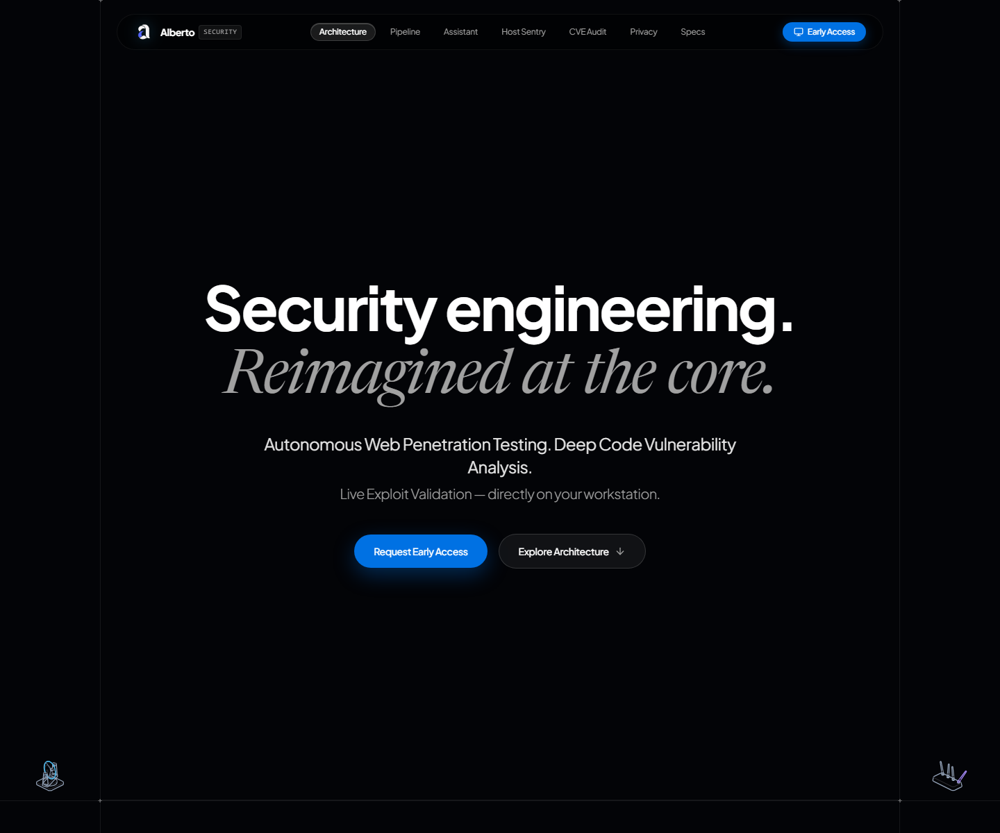

# Noraldeen Sayed

### Cybersecurity Graduate | Security Automation | AI-Assisted Engineering

I build practical security systems that connect code analysis, vulnerability research, controlled exploit validation, threat intelligence, and local AI workflows. My strongest work focuses on evidence, operator control, and tools that remain useful when cloud integrations are unavailable.

[](https://alberto-security.vercel.app/)
[](https://www.linkedin.com/in/noraldeen-sayed)
[](mailto:noraldeen2111@gmail.com)

## Flagship project: Alberto Security

[Alberto Security](https://alberto-security.vercel.app/) is my final-year project: a local-first desktop security workspace combining codebase analysis, dependency and CVE research, controlled DAST validation, remediation workflows, host checks, security reporting, and multi-provider AI support, including local Ollama models.

[](https://alberto-security.vercel.app/)

The source repository remains private. The linked product site presents the architecture, workflows, and interface without exposing the codebase.

## Selected engineering work

| Project | What it demonstrates |
| --- | --- |
| [CYBERCORE CTI](https://github.com/NorShadeed/cybercore-cti) | Source-traceable threat intelligence, deterministic IOC extraction, ATT&CK mapping, STIX 2.1 export, and local-first persistence. |
| [CyberGuard Academy](https://github.com/NorShadeed/cyberguard-academy) | Scenario-driven phishing, social-engineering, password-security, and incident-response training with branching decisions, scoring, progress, and certificates. |
| [SCAN VA Toolkit](https://github.com/NorShadeed/scan-va-toolkit) | Authorized subdomain enumeration, concurrent live-host checks, same-origin crawling, API discovery, CLI and Windows desktop interfaces. |
| [Explainable IoT IDS](https://github.com/NorShadeed/iot-ids-xai) | DNN-BiLSTM modeling, genetic feature selection, LIME explanations, dynamic quantization, and a Gradio analysis interface. |
| [AI-Assisted Web Pentester](https://github.com/NorShadeed/ai-pentester) | Crawling, Playwright automation, XSS and SQLi validation workflows, live progress events, and remediation-focused reporting. |

## Technical focus

- **Security engineering:** vulnerability assessment, web application testing, threat intelligence, network traffic analysis, endpoint security, secure automation.
- **Programming and platforms:** Python, TypeScript/JavaScript, React, Electron, Flask/FastAPI, SQL, Linux, Docker, GitHub Actions.
- **AI engineering:** Ollama, Claude, OpenAI/Codex, APIs, MCP, tool-using agents, structured outputs, agentic workflows, and local/cloud model integration.
- **Security tooling:** Burp Suite, Nmap, Wireshark, Scapy, Metasploit, Playwright, Ghidra, and CVE/ATT&CK data workflows.

## Certifications and education

- **Certified Network Security Practitioner (CNSP), with Merit** - The SecOps Group / PentestingExams.com, July 2026. [Validate certificate ID 11668106](https://pentestingexams.com/certificate-validation/).
- **Certified AD Red Team Specialist (AD-RTS)** - [CyberWarFare Labs](https://www.linkedin.com/company/cyberwarfarelabs/).
- **SOC Analyst Learning Path** - LetsDefend.
- **Red Hat System Administration I** - Coursework.
- **BSc (Hons) Cyber Security** - Asia Pacific University; programme completed, final results pending.

## Engineering principles

```text
Evidence over hype. Human approval for risky actions. Secrets stay out of source control.
Automate repeatable work. Keep security tooling scoped, testable, and explainable.
```
